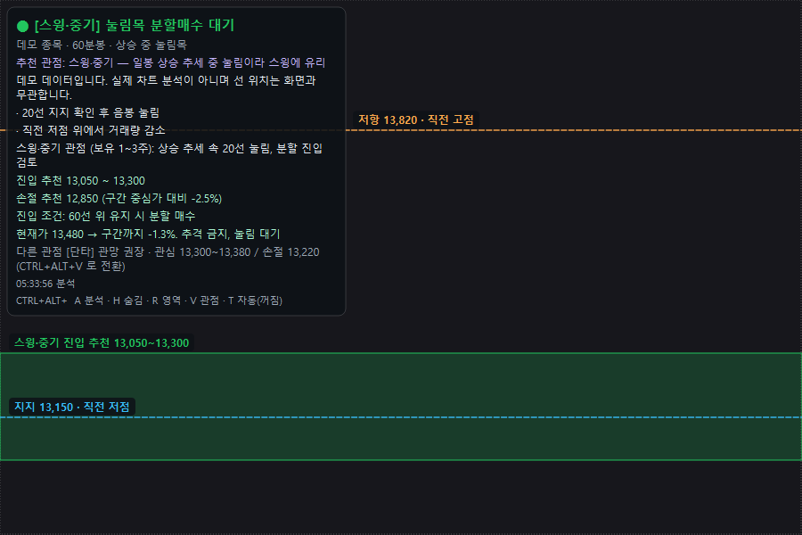

# TradeVision HUD

증권사 웹 차트를 캡처해 AI(Gemini Vision)가 지지·저항과 진입·손절 가격을 판독하고, 그 결과를 차트 위 투명 오버레이로 그려 주는 **Windows용 개인 매매 보조 도구**입니다.

> ⚠️ **투자 조언이 아닙니다.** AI 판독은 틀릴 수 있고, 이 프로그램은 주문 기능이 없습니다. 모든 매매 판단과 책임은 사용자에게 있습니다. 개인 학습·포트폴리오용 프로젝트이며 배포·판매하지 않습니다.

| 스윙 관점 (60분봉, 추천 관점) | 단타 관점 (Ctrl+Alt+V 로 전환) |
|---|---|
|  |  |

<sub>데모 데이터로 그린 화면입니다.</sub>

## 주요 기능

- **차트 영역 캡처 → AI 분석 → 투명 오버레이**: 클릭과 휠은 뒤의 차트로 그대로 전달됩니다.
- **필요한 선만 표시**: 지지선, 저항선, 진입 추천(또는 조건부 관심) 구간, 손절 추천가만 그립니다. 익절은 사용자가 판단합니다.
- **봉 주기별 관점**

  | 봉 주기 | 관점 |
  |---|---|
  | 1~15분 | 단타 (보유 당일~1·2일) |
  | 30·60분 | 단타와 스윙을 둘 다 분석하고, 어느 쪽이 맞는지 추천 |
  | 일·주·월 | 스윙·중기 (보유 수일~1개월) |

- **매매 원칙은 코드가 최종 판정**: 추격 매수 구간 차단, 손절가가 진입 구간 아래에 있는지 검증, 관점별 손절폭 경고.
- **줌·스크롤 추적**: 차트를 확대·이동하면 가격축 숫자를 Windows 내장 OCR로 다시 읽어 선을 옮깁니다(AI 호출 없음, 약 30ms).
- **장애 대응**: 모델이 혼잡(503)·한도 초과(429)·시간 초과(504)이면 다른 모델로 자동 전환하고, 시도별 결과를 로그로 남깁니다.

## 설계에서 신경 쓴 점

1. **AI에게는 좌표가 아니라 가격만 받습니다.** 비전 모델은 가격은 잘 읽어도 화면 위치는 자주 틀립니다. 실제 캡처에서 AI가 읽은 가격축 때문에 선이 최대 약 90px 어긋나는 사례가 있었습니다. 그래서 가격축은 OCR로 직접 측정하고, 회귀식으로 가격을 화면 위치로 바꿉니다. 이렇게 해서 오차를 1~2px로 줄였습니다.
2. **산술과 규칙은 코드가 맡습니다.** 손절폭 계산, 추격 매수 판정, 관점 배정은 AI 응답을 그대로 믿지 않고 코드에서 검증합니다.
3. **오버레이는 캡처에서 제외됩니다** (`SetWindowDisplayAffinity`). AI가 자기가 그린 선을 다시 읽는 피드백 루프를 막습니다.
4. **응답 지연 튜닝**: 모델의 생각(thinking) 수준을 조절해 응답 시간을 약 9.5초 → 5초로 줄였습니다. 정확도는 테스트 이미지 기준으로 유지됐습니다.

## 구조

```
main.py               실행 진입점
tvhud/
  app.py              트레이·단축키·캡처·분석 흐름·줌 추적 루프
  analyzer.py         Gemini 호출, 응답 스키마, 시스템 프롬프트, 모델 자동 선택/대체
  rules.py            가격축 회귀(가격→y), 매매 원칙 검증, 단타/스윙 관점 계획
  axis_ocr.py         Windows OCR 가격축 판독(줌/스크롤 추적)
  overlay.py          클릭 투과 투명 HUD 렌더링
  roi_selector.py     드래그로 차트 영역 지정
  hotkeys.py          Win32 RegisterHotKey 전역 단축키
  config.py           설정(%LOCALAPPDATA%\TradeVisionHUD\config.json)
```

## 실행

요구 사항: Windows 10(2004 이상)/11, Python 3.11 이상, [Gemini API 키](https://aistudio.google.com/apikey)

```bat
run.bat          :: 첫 실행 시 가상환경 생성 + 패키지 설치
run_demo.bat     :: API 키 없이 데모 화면만 보기
```

1. 차트 영역을 드래그로 지정합니다. 오른쪽 가격축 숫자가 반드시 들어가야 합니다.
2. **Ctrl+Alt+A**를 눌러 분석합니다. 처음 한 번은 API 키를 입력합니다.

| 단축키 | 동작 |
|---|---|
| Ctrl+Alt+A | 분석 |
| Ctrl+Alt+V | 단타 ↔ 스윙 선 전환 |
| Ctrl+Alt+H | 오버레이 표시/숨김 |
| Ctrl+Alt+R | 영역 다시 지정 |
| Ctrl+Alt+T | 자동 갱신 |
| Ctrl+Alt+Q | 종료 |

자세한 사용법은 [사용설명서.md](사용설명서.md), 설계 배경은 [프로그램 기획서.md](프로그램%20기획서.md)를 참고하세요.

## 개인정보·보안

- API 키와 분석 로그는 `%LOCALAPPDATA%\TradeVisionHUD`에만 저장되고, 이 저장소에는 포함되지 않습니다.
- 지정한 차트 영역의 이미지만 Gemini API로 전송됩니다. 계좌·잔고가 영역에 들어가지 않게 지정하세요.

## 한계

- 실제 장중에서의 타점 적중률은 아직 검증하지 않았습니다.
- Gemini 무료 등급은 일일 한도가 작고, 혼잡할 때는 분석이 실패할 수 있습니다.
- 차트 창을 옮기거나 크기를 바꾸면 영역을 다시 지정해야 합니다.

## 개발 방식

기획, 설계 결정, 테스트·검증은 직접 진행했고, 구현에는 AI 코딩 도구(Claude Code)를 활용했습니다.
