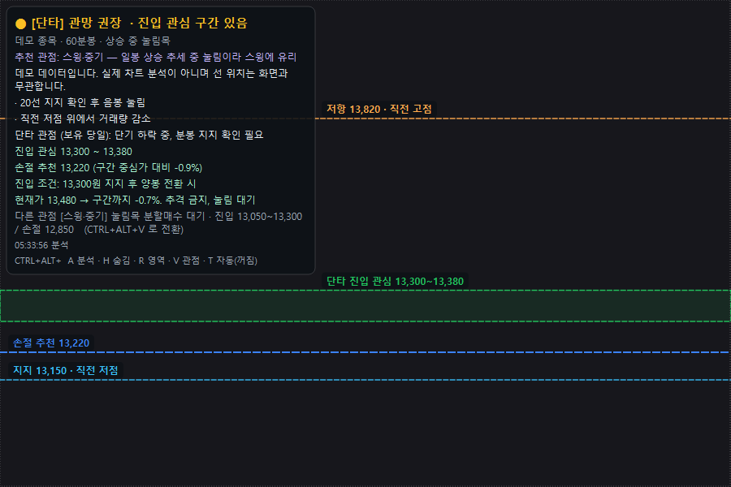

# TradeVision HUD

증권사 웹 차트를 캡처해 AI(Gemini Vision)가 지지·저항과 진입·손절 가격을 판독하고, 그 결과를 차트 위 투명 오버레이로 그려 주는 **Windows용 개인 매매 보조 도구**입니다.

> ⚠️ **투자 조언이 아닙니다.** AI 판독은 틀릴 수 있고, 이 프로그램은 주문 기능이 없습니다. 모든 매매 판단과 책임은 사용자에게 있습니다. 개인 학습·포트폴리오용 프로젝트이며 배포·판매하지 않습니다.

| 스윙 관점 (60분봉, 추천 관점) | 단타 관점 (Ctrl+Alt+V 로 전환) |
|---|---|
|  |  |

<sub>데모 데이터로 그린 화면입니다.</sub>

## 주요 기능

- **차트 영역 캡처 → AI 분석 → 투명 오버레이**: 클릭과 휠은 뒤의 차트로 그대로 전달됩니다.
- **필요한 선만 표시**: 지지선, 저항선, 진입 추천(또는 조건부 관심) 구간, 손절 추천가만 그립니다. 익절은 사용자가 판단합니다.
- **봉 주기별 관점**

  | 봉 주기 | 관점 |
  |---|---|
  | 1~15분 | 단타 (보유 당일~1·2일) |
  | 30·60분 | 단타와 스윙을 둘 다 분석하고, 어느 쪽이 맞는지 추천 |
  | 일·주·월 | 스윙·중기 (보유 수일~1개월) |

- **매매 원칙은 코드가 최종 판정**: 추격 매수 구간 차단, 손절가가 진입 구간 아래에 있는지 검증, 관점별 손절폭 경고.
- **줌·스크롤 추적**: 차트를 확대·이동하면 가격축 숫자를 Windows 내장 OCR로 다시 읽어 선을 옮깁니다(AI 호출 없음, 약 30ms).
- **장애 대응**: 모델이 혼잡(503)·한도 초과(429)·시간 초과(504)이면 다른 모델로 자동 전환하고, 시도별 결과를 로그로 남깁니다.

## 문제 해결 기록

### 1. AI가 그린 선이 캔들과 최대 약 90px 어긋남

**상황**
처음에는 AI가 읽어 준 가격축 눈금(가격과 화면 y좌표)으로 회귀식을 만들어 선을 그렸습니다. 그런데 저장된 실제 캡처를 다시 확인해 보니, 선이 최대 약 90px 어긋나는 경우가 있었습니다. 지지선이 캔들과 맞지 않으면 이 도구를 쓸 이유가 없습니다.

**원인**
비전 모델은 가격 숫자는 잘 읽지만, 그 숫자가 화면 어디에 있는지는 자주 틀렸습니다. 문제의 캡처에서는 AI가 눈금 간격을 실제와 다르게 읽어, 가장 아래 눈금을 화면 맨 밑으로 잡았습니다.

**해결** (`axis_ocr.py`, `rules.py`)
- 가격축 숫자를 Windows 내장 OCR로 PC에서 직접 읽어 눈금의 실제 위치를 측정합니다.
- 측정한 눈금(가격, y)으로 최소제곱 회귀식을 만들어 가격을 화면 위치로 바꿉니다. OCR 측정값이 있으면 그것을 쓰고, AI가 읽은 좌표는 OCR이 실패했을 때의 예비값으로만 씁니다.
- 잘못 읽은 눈금이 섞여 오차가 크면 눈금을 하나씩 빼 보며 다시 맞추고, 로그 스케일 차트인지도 판별합니다.

**부작용 대비**
- OCR로 가격축을 읽지 못하면 AI가 읽은 축으로 돌아가되, "선 위치가 틀릴 수 있다"는 경고를 띄웁니다.
- 줌·스크롤 뒤 가격축을 읽을 수 없으면 선을 흐리게 하고 재분석을 안내합니다.

**결과**
- 시뮬레이션(화면 배율 100·125·150%)에서 선 위치 오차가 1~2px였습니다.
- 줌·스크롤해도 AI를 다시 부르지 않고, 0.5초마다 가격축을 다시 읽어 선이 따라옵니다(OCR 1회 약 30ms).
- 저장된 실제 캡처 36장 중, 가격축이 온전히 보이는 캡처는 대부분 OCR로 읽었습니다(36장 중 28장). 읽지 못한 캡처는 대부분 5번 문제의 원인인 가격축 잘림이었습니다.

### 2. AI가 자기가 그린 선을 다시 읽을 위험 (설계 단계에서 예상)

**예상한 문제**
오버레이가 떠 있는 상태로 차트를 캡처하면 이전 분석의 선이 이미지에 같이 찍힙니다. 그러면 AI가 그 선을 지지·저항으로 다시 읽어, 잘못된 판단이 스스로 강화될 수 있습니다.

**해결** (`overlay.py`)
`SetWindowDisplayAffinity`로 오버레이 창을 화면 캡처에서 제외했습니다.

**부작용 대비**
이 설정이 적용되지 않는 환경에서는 캡처하는 순간에만 오버레이를 잠깐 숨겼다가 다시 띄웁니다.

### 3. 분석 한 번에 약 9.5초

**상황**
단축키를 누르고 선이 뜨기까지 약 9.5초가 걸려, 분봉 매매를 보조하기에는 느렸습니다.

**원인**
응답을 측정해 보니 모델이 답하기 전에 내부 추론(thinking)에 많은 토큰을 쓰고 있었습니다(약 1,300 토큰).

**해결** (`analyzer.py`)
모델의 생각 수준을 낮춰(`low`) 약 5초로 줄였습니다. 가장 낮은 수준(`minimal`)에서는 약 2.7초였습니다.

**부작용 대비**
- 생각을 줄이면 판독이 부정확해질 수 있어서, 같은 테스트 이미지로 가격축 판독값이 유지되는지 확인한 뒤 적용했습니다.
- 수준은 설정에서 바꿀 수 있고, thinking 설정을 지원하지 않는 모델은 설정 없이 자동으로 다시 호출합니다.

### 4. 구글 서버 혼잡으로 분석 실패

**상황**
첫 분석은 잘 되다가 재분석에서 "서버 혼잡" 오류가 반복됐습니다.

**원인 찾기**
- 처음 버전은 같은 모델로 재시도만 하다가 실패했지만, 실패 이유가 기록되지 않아 원인을 알 수 없었습니다.
- 모델 호출마다 결과를 `attempts.log`에 남기게 바꾸자 원인이 드러났습니다. 최신 모델 여러 개가 503(혼잡)을 내고 있었고, 그다음 모델은 40초를 기다린 끝에 504(시간 초과)로 실패해 시간 예산을 혼자 다 쓰고 있었습니다.

**해결** (`analyzer.py`)
- 계정에서 쓸 수 있는 Flash 모델 목록을 받아 정렬하고, 실패하면 기다리지 않고 다음 모델로 넘어갑니다.
- 모델 1회 대기는 40초에서 20초로 줄였습니다. 정상 응답이 4~10초이기 때문입니다.
- 직전까지 잘 되던 모델이 503을 내면 일시적인 경우가 많아, 1.5초 뒤 같은 모델로 한 번 더 시도합니다.
- 실패한 모델은 2분 동안 뒤로 미룹니다.

**부작용 대비**
- 분석 1회에 최대 7번, 60초까지만 시도해 무한 대기를 막습니다.
- 여러 오류가 섞이면 사용자가 직접 조치할 수 있는 한도 초과(429)를 먼저 안내합니다.
- 고친 뒤 새 버그를 발견했습니다. 혼잡할 때 대안으로 쓴 정확도 낮은 lite 모델이 "마지막 성공 모델"로 기억돼 계속 쓰이고 있었습니다. 그래서 lite 모델은 비상용으로만 쓰고 기억하지 않게 바꿨습니다.

### 5. 가격축이 잘려 엉뚱한 가격으로 분석

**상황**
잘 되던 줌 추적이 갑자기 동작하지 않고, 화면이 바뀔 때마다 선이 흐려지기만 했습니다. 같은 시점의 분석 결과에서 AI는 실제 40원대 종목의 현재가를 4,350원으로 읽었습니다.

**원인**
영역을 지정한 뒤 브라우저 창 크기가 바뀌어, 지정 영역의 오른쪽 끝이 가격축 숫자를 잘라 첫 글자만 보이고 있었습니다. 그래서 OCR은 축을 읽지 못했고, AI는 잘린 숫자를 추측으로 읽었습니다. 사용하면서 "가격축이 안 보여서 그런 것 같다"고 원인을 먼저 짚은 뒤, 저장된 캡처로 확인했습니다.

**해결** (`app.py`, `axis_ocr.py`, `roi_selector.py`)
- AI에 보내기 전에 가격축이 보이는지 PC에서 먼저 확인합니다(약 0.2초). 잘렸으면 **API를 호출하지 않고** 영역 지정 화면을 띄우고, 다시 지정하면 분석을 이어 갑니다.
- 영역을 지정할 때도 가격축이 들어 있는지 확인하고, 없으면 안내와 함께 다시 지정하게 합니다.
- AI가 읽은 현재가가 OCR로 측정한 가격축 범위와 동떨어지면 "이번 분석은 신뢰하기 어렵다"고 경고합니다.
- 함께 고친 것: 가격축 열을 고를 때 "현재가의 1/3~3배"만 쓰던 필터가, 범위가 넓은 차트에서 정상 눈금까지 버리고 있었습니다. 그래서 필터 대신 "위에서 아래로 값이 계속 작아지는 오른쪽 숫자 열"을 가격축으로 고르게 바꿨습니다.

**부작용 대비**
가격축이 보이는데도 OCR이 못 읽는 차트가 있을 수 있어서, 안내 화면에서 Esc를 누르면 확인을 건너뛰고 그대로 분석할 수 있게 했습니다.

### 공통 원칙: AI 응답을 그대로 믿지 않는다
손절폭 계산, 추격 매수 판정(진입 구간이 현재가보다 위면 무효), 손절가 위치 검증, 봉 주기별 단타·스윙 관점 배정은 AI가 아니라 코드가 최종 판정합니다(`rules.py`).

## 구조

```
main.py               실행 진입점
tvhud/
  app.py              트레이·단축키·캡처·분석 흐름·줌 추적 루프
  analyzer.py         Gemini 호출, 응답 스키마, 시스템 프롬프트, 모델 자동 선택/대체
  rules.py            가격축 회귀(가격→y), 매매 원칙 검증, 단타/스윙 관점 계획
  axis_ocr.py         Windows OCR 가격축 판독(줌/스크롤 추적)
  overlay.py          클릭 투과 투명 HUD 렌더링
  roi_selector.py     드래그로 차트 영역 지정
  hotkeys.py          Win32 RegisterHotKey 전역 단축키
  config.py           설정(%LOCALAPPDATA%\TradeVisionHUD\config.json)
```

## 실행

요구 사항: Windows 10(2004 이상)/11, Python 3.11 이상, [Gemini API 키](https://aistudio.google.com/apikey)

```bat
run.bat          :: 첫 실행 시 가상환경 생성 + 패키지 설치
run_demo.bat     :: API 키 없이 데모 화면만 보기
```

1. 차트 영역을 드래그로 지정합니다. 오른쪽 가격축 숫자가 반드시 들어가야 합니다.
2. **Ctrl+Alt+A**를 눌러 분석합니다. 처음 한 번은 API 키를 입력합니다.

| 단축키 | 동작 |
|---|---|
| Ctrl+Alt+A | 분석 |
| Ctrl+Alt+V | 단타 ↔ 스윙 선 전환 |
| Ctrl+Alt+H | 오버레이 표시/숨김 |
| Ctrl+Alt+R | 영역 다시 지정 |
| Ctrl+Alt+T | 자동 갱신 |
| Ctrl+Alt+Q | 종료 |

자세한 사용법은 [사용설명서.md](사용설명서.md), 설계 배경은 [프로그램 기획서.md](프로그램%20기획서.md)를 참고하세요.

## 개인정보·보안

- API 키와 분석 로그는 `%LOCALAPPDATA%\TradeVisionHUD`에만 저장되고, 이 저장소에는 포함되지 않습니다.
- 지정한 차트 영역의 이미지만 Gemini API로 전송됩니다. 계좌·잔고가 영역에 들어가지 않게 지정하세요.

## 한계

- 실제 장중에서의 타점 적중률은 아직 검증하지 않았습니다.
- Gemini 무료 등급은 일일 한도가 작고, 혼잡할 때는 분석이 실패할 수 있습니다.
- 차트 창을 옮기거나 크기를 바꾸면 영역을 다시 지정해야 합니다.

## 개발 방식

기획, 설계 결정, 테스트·검증은 직접 진행했고, 구현에는 AI 코딩 도구(Claude Code)를 활용했습니다.
